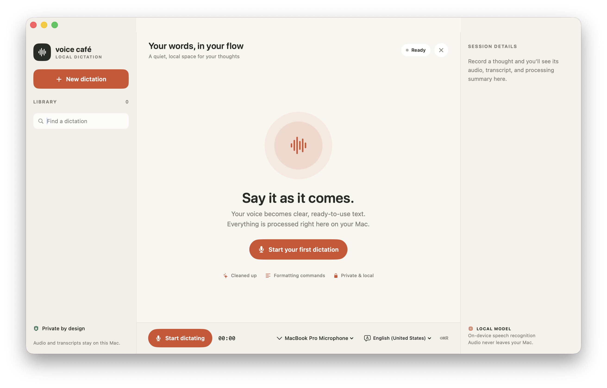

# Voice Café

Voice Café is a native macOS dictation app that turns speech into editable text while keeping recordings and transcription on your Mac.

## Preview

## Features

- Record from a selected microphone, with an input-level indicator.
- Show live partial text through Apple Speech when Speech Recognition permission is enabled and the selected language supports on-device recognition.
- Use WhisperKit as a local fallback when Apple Speech returns no words. Whisper model files are downloaded once and cached; audio transcription runs on-device.
- Review the raw transcript and a polished version, edit the result, then share it with compatible macOS apps or copy it from the Share button’s context menu.
- Apply local cleanup for filler words, spacing, capitalization, punctuation, and spoken formatting commands such as “new line,” “new paragraph,” “comma,” and “question mark.”
- Keep a searchable history of dictations and their audio recordings; reopen previous sessions or delete a session and its audio.
- View session duration, word count, processing steps, and a summary.

## Requirements

- macOS 14 or later
- Xcode 16 or later
- Internet access the first time WhisperKit downloads its model files

## Build and run

1. Open `VoiceCafe.xcodeproj` in Xcode.
2. Select the `VoiceCafe` scheme and run it on your Mac.
3. Allow microphone access. Allow Speech Recognition for live partial text; if you decline, recording and the local Whisper fallback remain available, but text appears after recording finishes.
4. Choose the microphone and language from the controls along the bottom of the window.

Press **⇧⌘R** to start or stop recording, **⌘N** for a new dictation, and **⌥⌘C** to copy the polished transcript. The Share button opens macOS sharing destinations for compatible apps; right-click it to copy. Paste copied text into another app with **⌘V**.

## Local storage and privacy

Session metadata and transcripts are stored in `sessions.json`; audio files are stored alongside it in:

`~/Library/Application Support/VoiceCafe/`

Speech recognition runs locally using Apple’s on-device Speech recognizer or WhisperKit. Voice Café does not send audio to a transcription API. Whisper model files are fetched from the internet on first use and cached locally.

## Implementation

- SwiftUI interface and session history
- AVFoundation microphone capture and WAV recording
- Apple Speech live recognition and saved-audio fallback
- WhisperKit local transcription fallback
- Rule-based, on-device transcript cleanup
